# Agree a Block Before You Book It

> Inside the [Leadership Systems Engineering](../../README.md) portfolio · *Leadership frameworks from formal coursework, engineered as working systems.*

## Overview

I designed a proposed 90-minute morning Block for completing the monthly report on Tuesdays and Thursdays. Before creating a recurring calendar booking, I needed Sam and Priya to understand the schedule, know which urgent situations could interrupt it, and agree to protect the time. The agreement would be recorded in Notion before the Block appeared as a standing commitment.

The plan also defined how the practice would be judged. After agreement, I would classify eight Blocks as INTACT or BROKEN and compare the count with a fixed cutoff. This order mattered because a calendar event alone could not prove that the people affected by my availability had accepted the boundary. Agreement had to establish the shared rule before scheduling attempted to enforce it.

The architecture is built across **7 phases**, anchored by **Defining the Work Worth Protecting** on the input side and **Pressure-Testing the Agreement Rules** at the end. Each phase is listed in the Implementation section below.

## Architecture

```mermaid
---
title: Agree a Block Before You Book It
---
%%{init: {"theme":"base","themeVariables": {"primaryColor":"#1B4332","primaryTextColor":"#F4D03F","primaryBorderColor":"#F4D03F","secondaryColor":"#264653","tertiaryColor":"#2F5233","lineColor":"#F4D03F","fontFamily":"ui-monospace, SFMono-Regular, Menlo, Consolas, monospace","fontSize":"13px"}}}%%
flowchart TD
    classDef datastore fill:#264653,stroke:#F4D03F,stroke-width:2px,color:#FFFFFF
    classDef service fill:#1B4332,stroke:#F4D03F,stroke-width:2px,color:#F4D03F
    classDef event fill:#7B42BC,stroke:#F4D03F,stroke-width:2px,color:#FFFFFF
    classDef io fill:#0d1117,stroke:#F4D03F,stroke-width:1.5px,color:#F4D03F,font-style:italic

    Colleagues[/The two colleagues whose access to the operator is what is actually being asked for/]
    Verdict[/The operator on day 66, applying a branch written before the first Block/]

    subgraph Order["The rule that sets the whole sequence"]
        Before{{Agreement comes before booking, because a calendar event cannot show that the people affected accepted the boundary}}
        Imposed{{A recurring event visible only on one calendar would imply a reduction in access that nobody consented to}}
    end

    subgraph Page["One shared page, in a deliberate order"]
        Notion(A Notion page holding the proposal, exceptions, permissions, replies, habit rules, tally, cost questions and verdict)
        Urgent[("The page opens with the line that anything genuinely urgent is always taken, listed or not")]
        First{{Placing the urgent rule above the work being protected means the safety boundary is read before the request is}}
        NotDemand{{It stops the Block from reading as a demand to ignore a serious problem}}
    end

    subgraph Access["Who may interrupt, and on what condition"]
        RowOne[("One colleague may interrupt when a customer is already on the phone")]
        RowTwo[("The other may interrupt when the system has stopped")]
        Duplicated{{The same wording is written in two places, so a later proposal cannot quietly widen or narrow either condition}}
        Wait{{Anything else from either person waits until the 90 minutes end}}
        TwoLevels{{Two layers: named conditions for expected interruptions, and the opening rule for an emergency the list never predicted}}
    end

    subgraph Draft["A proposal that says it is only a proposal"]
        Proposal[("Tuesdays and Thursdays 9:00 to 10:30, the monthly report, and a review date")]
        Guess[(A line stating plainly that the length is a guess)]
        Status[(Status set to NOT AGREED, DO NOT BOOK)]
        Testable{{Naming the guess stops 90 minutes becoming permanent merely because it was written first}}
        Revisit{{The length is to be reconsidered after the first two Blocks, from experience rather than from the original estimate}}
    end

    subgraph Clear["Both tools made to agree"]
        Check(Google Calendar checked across the proposed slots)
        Empty[(No recurring Block exists, matching the NOT AGREED status on the page)]
        Meaning{{Keeping the calendar clear preserves what a future event will mean: an agreement, not an intention imposed on others}}
    end

    subgraph Ask["The request, and what a No does"]
        InPerson(The proposal put as a complete question the two colleagues can answer, asked in person)
        Awaiting[(Status moved to PROPOSAL SENT, AWAITING REPLIES, with the calendar still clear)]
        OneRevision{{A first No earns one revised proposal, not the original schedule booked anyway}}
        Stop{{A second No is recorded with who declined and why, and the tally never starts}}
        NoPressure{{This is what stops repeated asking from becoming pressure dressed as consent}}
        Partial{{Agreement from one person is recorded as agreement with that person alone, and the recurring Block stays off the calendar until everyone affected has accepted}}
    end

    subgraph Rules["Definitions fixed before any Block ran"]
        Marks[(INTACT and BROKEN defined, with eight blank tally lines)]
        Cutoff[(The acceptance boundary fixed at 6 intact Blocks out of 8)]
        Costs[(Cost questions and nine limits written down before Block one)]
        Comparable{{Fixing the definitions first keeps all eight marks comparable, rather than judged against explanations invented after an interruption}}
        AfterRules(The two review dates scheduled only once the rules were fixed)
    end

    subgraph Hard["The edge cases, classified in advance"]
        Listed[("A listed customer call: INTACT, because the agreement allows it")]
        Gmail[("Opening mail and stopping the report work: BROKEN")]
        Moved[("Moving the Block for a meeting: BROKEN, because the protected time did not hold")]
        Emergency[("A real emergency: taken, and the Block still marked BROKEN")]
        Hardest{{The emergency case takes the most judgment, because responding was right and the session still failed}}
        Distinct{{The classification separates a good human decision from a successful focus session, and refuses to let the first excuse the second}}
    end

    subgraph Held["What was deliberately not edited"]
        Appended(The edge cases added under their own heading, with the earlier sections left untouched)
        Same[(The urgent rule still first, both access rows still word for word, the cutoff still 6 of 8)]
        Weaken{{Rewriting an exception to make an awkward case look INTACT would drain the meaning from the later tally}}
    end

    subgraph Bounds["What is not claimed"]
        Pending{{Agreement is still outstanding, no Block has been booked and no tally has begun}}
        NewAgreement{{Any revised duration is to become a new shared agreement rather than a silent calendar edit}}
    end

    Colleagues -- "are the reason for" --> Before
    Before -- "exists because of" --> Imposed
    Before -- "realised as" --> Notion
    Notion -- "opens with" --> Urgent
    Urgent -- "placed to give" --> First
    First -- "delivers" --> NotDemand
    Urgent -- "followed by" --> RowOne
    Urgent -- "followed by" --> RowTwo
    RowOne -- "written twice, giving" --> Duplicated
    RowTwo -- "bounded by" --> Wait
    Urgent -- "combines with the rows to give" --> TwoLevels
    Notion -- "records" --> Proposal
    Proposal -- "qualified by" --> Guess
    Proposal -- "marked" --> Status
    Guess -- "keeps the duration" --> Testable
    Testable -- "scheduled as" --> Revisit
    Status -- "checked against" --> Check
    Check -- "found" --> Empty
    Empty -- "preserves" --> Meaning
    Proposal -- "put as" --> InPerson
    InPerson -- "moves status to" --> Awaiting
    InPerson -- "answered No once, giving" --> OneRevision
    OneRevision -- "answered No again, giving" --> Stop
    Stop -- "is what delivers" --> NoPressure
    InPerson -- "answered by one only, giving" --> Partial
    Partial -- "keeps" --> Empty
    Notion -- "fixes" --> Marks
    Marks -- "paired with" --> Cutoff
    Marks -- "accompanied by" --> Costs
    Cutoff -- "fixed first, giving" --> Comparable
    Comparable -- "only then scheduling" --> AfterRules
    Marks -- "tested against" --> Listed
    Marks -- "tested against" --> Gmail
    Marks -- "tested against" --> Moved
    Marks -- "tested against" --> Emergency
    Emergency -- "is why" --> Hardest
    Hardest -- "resolved by" --> Distinct
    Listed -- "recorded by" --> Appended
    Emergency -- "recorded by" --> Appended
    Appended -- "left intact" --> Same
    Same -- "protected because" --> Weaken
    AfterRules -- "read on the day by" --> Verdict
    Cutoff -- "applied by" --> Verdict
    Distinct -- "governs what the tally can say to" --> Verdict
    Verdict -- "bounded by" --> Pending
    Revisit -- "bounded by" --> NewAgreement
    Colleagues -- "must accept before anything is booked" --> Partial

    class Urgent,RowOne,RowTwo,Proposal,Guess,Status,Empty,Awaiting,Marks,Cutoff,Costs,Listed,Gmail,Moved,Emergency,Same datastore
    class Notion,Check,InPerson,AfterRules,Appended service
    class Before,Imposed,First,NotDemand,Duplicated,Wait,TwoLevels,Testable,Revisit,Meaning,OneRevision,Stop,NoPressure,Partial,Comparable,Hardest,Distinct,Weaken,Pending,NewAgreement event
    class Colleagues,Verdict io
```

The diagram shows the topology and data flow of the system as built. The full architectural narrative, with screenshots and prose, lives in [`documents/block-agreement-before-booking.md`](./documents/block-agreement-before-booking.md).

## Implementation

This system is built across **7 phases**:

1. **Defining the Work Worth Protecting**
2. **Creating a Shared Home for Urgent Access**
3. **Clarifying Who Can Interrupt the Block**
4. **Drafting a Block Before Agreement**
5. **Asking Others to Protect the Time**
6. **Establishing Fixed Rules and Review Dates**
7. **Pressure-Testing the Agreement Rules**

For the full walkthrough with screenshots and step-by-step content, see [`documents/block-agreement-before-booking.md`](./documents/block-agreement-before-booking.md).

## Validation

Each build phase below is documented in [`documents/block-agreement-before-booking.md`](./documents/block-agreement-before-booking.md), with screenshots, configuration, and notes as captured during the build:

- ✅ Defining the Work Worth Protecting
- ✅ Creating a Shared Home for Urgent Access
- ✅ Clarifying Who Can Interrupt the Block
- ✅ Drafting a Block Before Agreement
- ✅ Asking Others to Protect the Time
- ✅ Establishing Fixed Rules and Review Dates
- ✅ Pressure-Testing the Agreement Rules
