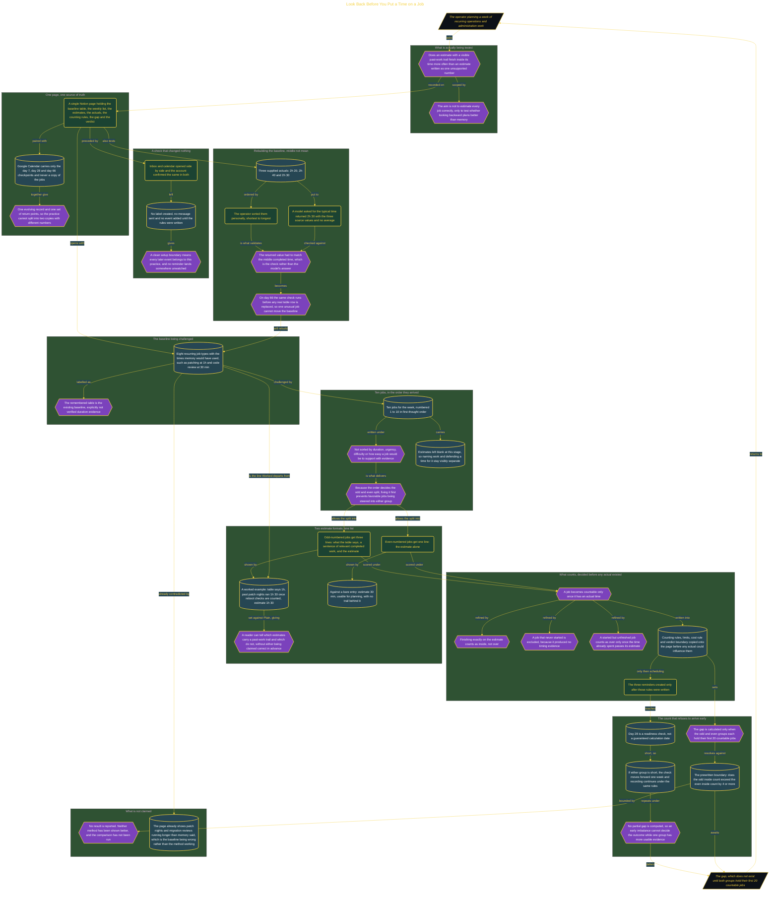

# Look Back Before You Put a Time on a Job

> Inside the [Leadership Systems Engineering](../../README.md) portfolio · *Leadership frameworks from formal coursework, engineered as working systems.*

## Overview

I built one Notion page to estimate recurring work from jobs I had already completed. The focus was my weekly operations and administration load, including status reports, invoice runs, server patching, code reviews, and backup checks. These jobs often ran beyond the time I expected, making the remembered estimates difficult to plan around.

The practice separated estimates supported by past work from estimates written as one unsupported number. I would later compare how often each group finished inside its estimate. The purpose was not to predict every job perfectly. It was to test whether looking backward at completed work produced a planning time that held up more often than relying on memory alone.

The architecture is built across **6 phases**, anchored by **Choosing a Recurring Job to Estimate Better** on the input side and **Rebuilding the Baseline with Checked Typical Times** at the end. Each phase is listed in the Implementation section below.

## Architecture

The diagram shows the topology and data flow of the system as built. The full architectural narrative, with screenshots and prose, lives in [`documents/evidence-backed-estimates.md`](./documents/evidence-backed-estimates.md).

## Implementation

This system is built across **6 phases**:

1. **Choosing a Recurring Job to Estimate Better**
2. **Creating a Home for the Recording Practice**
3. **Establishing the Remembered Baseline**
4. **Estimating New Jobs from Past Work**
5. **Protecting the Practice with Rules and Reminders**
6. **Rebuilding the Baseline with Checked Typical Times**

For the full walkthrough with screenshots and step-by-step content, see [`documents/evidence-backed-estimates.md`](./documents/evidence-backed-estimates.md).

## Validation

Each build phase below is documented in [`documents/evidence-backed-estimates.md`](./documents/evidence-backed-estimates.md), with screenshots, configuration, and notes as captured during the build:

- ✅ Choosing a Recurring Job to Estimate Better
- ✅ Creating a Home for the Recording Practice
- ✅ Establishing the Remembered Baseline
- ✅ Estimating New Jobs from Past Work
- ✅ Protecting the Practice with Rules and Reminders
- ✅ Rebuilding the Baseline with Checked Typical Times
