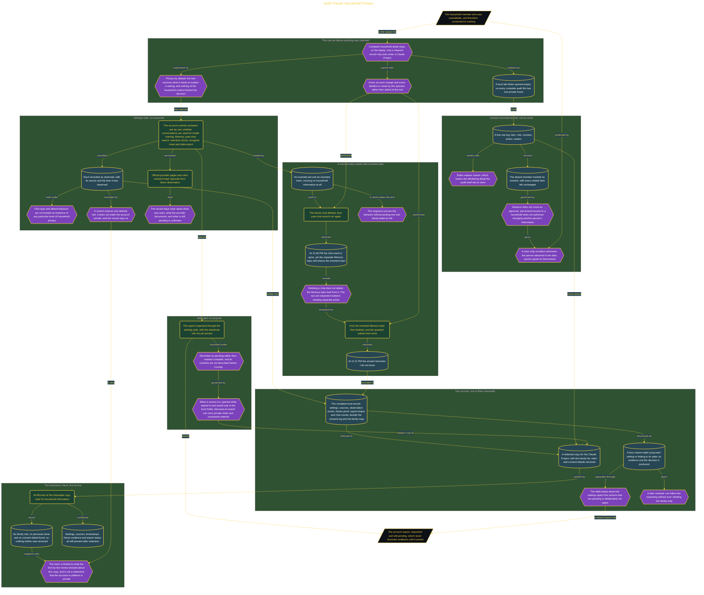

# Audit Claude Household Privacy

> Inside the [Leadership Systems Engineering](../../README.md) portfolio · *Leadership frameworks from formal coursework, engineered as working systems.*

## Overview

I created a local audit workspace before reviewing Claude settings, Memory, chats, or account data. The lab folder became the private location for complete records, including household roles, consent decisions, account observations, research evidence, timestamps, and the pending export. This established the privacy boundary before any sensitive information was collected.

The audit followed a local-first rule: full household details remained on my computer, while Claude could receive only a cleaned Settings Record when needed. I also retained control over every account change and chat deletion rather than asking Claude to act on my behalf. This setup allowed me to examine privacy behavior without exposing the family map or treating an online account as the primary home for audit evidence.

The architecture is built across **6 phases**, anchored by **Establishing a Privacy-First Audit Workspace** on the input side and **Demonstrating Least-Disclosure Practices** at the end. Each phase is listed in the Implementation section below.

## Architecture

The diagram shows the topology and data flow of the system as built. The full architectural narrative, with screenshots and prose, lives in [`documents/household-privacy-audit.md`](./documents/household-privacy-audit.md).

## Implementation

This system is built across **6 phases**:

1. **Establishing a Privacy-First Audit Workspace**
2. **Planning Consent and Research Evidence**
3. **Verifying Settings, Memory, and Privacy Boundaries**
4. **Recording Export and Chat Review Decisions**
5. **Completing a Redacted, Evidence-Based Settings Record**
6. **Demonstrating Least-Disclosure Practices**

For the full walkthrough with screenshots and step-by-step content, see [`documents/household-privacy-audit.md`](./documents/household-privacy-audit.md).

## Validation

Each build phase below is documented in [`documents/household-privacy-audit.md`](./documents/household-privacy-audit.md), with screenshots, configuration, and notes as captured during the build:

- ✅ Establishing a Privacy-First Audit Workspace
- ✅ Planning Consent and Research Evidence
- ✅ Verifying Settings, Memory, and Privacy Boundaries
- ✅ Recording Export and Chat Review Decisions
- ✅ Completing a Redacted, Evidence-Based Settings Record
- ✅ Demonstrating Least-Disclosure Practices
