# Judge My Planning Habits

> Inside the [Leadership Systems Engineering](../../README.md) portfolio · *Leadership frameworks from formal coursework, engineered as working systems.*

## Overview

I reviewed every planning habit I currently used or had already stopped. Before opening any supporting record, I wrote a Rule for each habit that identified its purpose, one Number to inspect, a measurement window, and the condition that would lead to DROP. I then planned to assign each habit one verdict: DROP, HOLD, or KEEP.

I kept the inventory on one Notion Practice Page and scheduled a dated review for December 8, 2026. This mattered because familiar routines can continue without proof that they still serve their purpose. Writing the tests before checking the evidence reduced my ability to protect a favored habit by lowering its standard after seeing an inconvenient result.

The architecture is built across **7 phases**, anchored by **Committing to a Personal Planning Review** on the input side and **Making the Next Review Reproducible** at the end. Each phase is listed in the Implementation section below.

## Architecture

```mermaid
---
title: Judge My Planning Habits
---
%%{init: {"theme":"base","themeVariables": {"primaryColor":"#1B4332","primaryTextColor":"#F4D03F","primaryBorderColor":"#F4D03F","secondaryColor":"#264653","tertiaryColor":"#2F5233","lineColor":"#F4D03F","fontFamily":"ui-monospace, SFMono-Regular, Menlo, Consolas, monospace","fontSize":"13px"}}}%%
flowchart TD
    classDef datastore fill:#264653,stroke:#F4D03F,stroke-width:2px,color:#FFFFFF
    classDef service fill:#1B4332,stroke:#F4D03F,stroke-width:2px,color:#F4D03F
    classDef event fill:#7B42BC,stroke:#F4D03F,stroke-width:2px,color:#FFFFFF
    classDef io fill:#0d1117,stroke:#F4D03F,stroke-width:1.5px,color:#F4D03F,font-style:italic

    Habits[/Four planning habits, one of them already stopped, none of which had faced a recent decision/]
    Rematch[/The December 8 review, where the single surviving habit must earn KEEP or be dropped/]

    subgraph Inventory["Everything listed before anything was judged"]
        Judging(A Notion Practice Page opened with the heading JUDGING, Sat 3 Oct 2026)
        Four[("Four habits listed, including inbox skimming, which had already been stopped")]
        Complete{{Listing the full set first keeps a discontinued or awkward practice inside the review}}
        NotExcluded{{No habit can be left out because its records are thin or its likely result is unwelcome}}
    end

    subgraph Sources["Evidence sources confirmed, and kept as sources"]
        Access(Google Calendar in week view and Gmail at the inbox, both under the same account)
        NoResult[("The access check produced no number for any habit")]
        Roles{{The Practice Page holds decisions while Calendar and Gmail stay evidence, never a second copy of the decision}}
    end

    subgraph Routine["The review routine, written before any number was read"]
        Sentence(One sentence beginning On Tuesday, 8 December 2026, read aloud to confirm every condition appeared)
        Seven[("Rule, Number, Verdict, HOLD conditions, KEEP only conditions, stopping dropped habits, starting one new Practice")]
        NotOpen{{A routine fixed in advance keeps December from becoming an open-ended reconsideration}}
        NotPermanent{{Every surviving practice returns to a dated review rather than continuing through familiarity}}
    end

    subgraph Tests["One rule per habit, written with the records closed"]
        Closed(Gmail, Calendar and the older pages closed while the four rules were written)
        ForDrop[("A For: line naming the purpose and a DROP if: line holding one Number and a defined window")]
        Struck[("KEEP if I used it 7 times struck out, because frequency measures use and not purpose")]
        Example[("One rule requiring at least 3 Sunday look-backs within the previous 4 weeks")]
        Stopped[("Inbox skimming marked Stopped before its record was opened")]
        NoHindsight{{A threshold chosen while the answer is unknown cannot be placed just under the number it will judge}}
        Inspectable{{The rules may later be judged poorly chosen, but they cannot be rewritten to protect a favoured habit now}}
    end

    subgraph Evidence["Each number taken from one named source and one window"]
        Open(The supporting records opened only after all four rules were fixed)
        Sunday[("Sunday look-back: review events counted in Calendar across the 4 weeks before October 3, giving 2")]
        Routing[("Email routing: put-off entries counted in the routing page running log, giving 3 of 20")]
        Rebuild[("The list rebuild page held no completed count, so its Number line was omitted")]
        NoGuess{{A missing number stays missing rather than becoming zero or a reconstruction from incomplete notes}}
        OneWindow{{Counting only the named outcome inside the defined period keeps unrelated activity out of the result}}
    end

    subgraph Verdicts["Verdicts applied in the order already set"]
        Assign(Each observed number compared with the threshold chosen before it was known)
        DropThree[("DROP for the Sunday look-back, the list rebuild and inbox skimming")]
        Hold[("HOLD for email routing: a usable number existed, and it did not support KEEP")]
        HoldRule{{HOLD stays available only where a number exists, so an absent record cannot buy a habit more time}}
        Untouched{{No purpose, threshold, window or verdict order changed after the evidence was opened}}
    end

    subgraph Result["One result, with the denominator it was measured against"]
        Kept[("Kept count: 0, of 4 listed")]
        Denominator[("The denominator includes inbox skimming, because it appeared in the inventory and still needed a verdict")]
        NotKeep{{Email routing does not raise the count, because HOLD is not KEEP}}
        Humbling{{A zero that follows from the recorded decisions is consistent rather than a failure of the method}}
    end

    subgraph Active["What is actually being done until December"]
        RoutineLine(A ROUTINE section holding the one surviving habit: routing each email immediately after reading it)
        Above[("RESULT placed above the routine, so the count is read before the practice it produced")]
        Event[("A Calendar event titled Judge my planning habits for December 8, 2026, with one notification and the four review lines")]
        Temporary{{A HOLD habit continues as a temporary preference while it collects a new number, and faces the same written review}}
    end

    subgraph Repeatable["The path back to the evidence"]
        Next(A Next record: line per habit naming the exact location of the future Number and how much history to count)
        Log[("For email routing, the MY RUNNING LOG section of the routing page, with the window matching its DROP if: rule")]
        NoShopping{{Naming the source in advance removes the chance of selecting a kinder record later}}
        NotDecide{{The record location makes the evidence path visible without deciding the verdict}}
    end

    subgraph Limits["What the review cost, and what it cannot show"]
        Time[("About 1 hour 10 minutes against the page estimate of 55 minutes")]
        Purpose{{The hardest part was separating what a habit is for from how often it is performed}}
        NoCause{{A small personal record can guide the next action and cannot show a habit caused broader change}}
    end

    Habits -- "entered under" --> Judging
    Judging -- "lists" --> Four
    Four -- "gives" --> Complete
    Complete -- "is why" --> NotExcluded
    Four -- "needs evidence, so" --> Access
    Access -- "produced" --> NoResult
    NoResult -- "preserves" --> Roles
    Four -- "then held against" --> Sentence
    Sentence -- "covers" --> Seven
    Seven -- "gives" --> NotOpen
    NotOpen -- "and" --> NotPermanent
    Sentence -- "written with the sources" --> Closed
    Closed -- "produced" --> ForDrop
    ForDrop -- "replaced" --> Struck
    ForDrop -- "instanced by" --> Example
    Closed -- "also recorded" --> Stopped
    Closed -- "is what gives" --> NoHindsight
    NoHindsight -- "bounded by" --> Inspectable
    NoHindsight -- "only then" --> Open
    Example -- "measured by" --> Sunday
    ForDrop -- "measured by" --> Routing
    Open -- "found nothing to count in" --> Rebuild
    Rebuild -- "held under" --> NoGuess
    Open -- "constrained by" --> OneWindow
    Sunday -- "counted under" --> OneWindow
    Sunday -- "compared at" --> Assign
    Routing -- "compared at" --> Assign
    Rebuild -- "compared at" --> Assign
    Stopped -- "compared at" --> Assign
    Assign -- "returned" --> DropThree
    Assign -- "returned" --> Hold
    Hold -- "allowed by" --> HoldRule
    NoGuess -- "is why Rebuild fell to DROP" --> DropThree
    Assign -- "held under" --> Untouched
    DropThree -- "counted into" --> Kept
    Hold -- "counted into" --> Kept
    Kept -- "read with" --> Denominator
    Kept -- "unchanged by" --> NotKeep
    HoldRule -- "is what NotKeep enforces at the count" --> NotKeep
    Kept -- "read as" --> Humbling
    Hold -- "carried into" --> RoutineLine
    Kept -- "placed as" --> Above
    RoutineLine -- "scheduled by" --> Event
    RoutineLine -- "held as" --> Temporary
    NotPermanent -- "is what Temporary applies" --> Temporary
    RoutineLine -- "pointed back by" --> Next
    Next -- "names" --> Log
    Log -- "gives" --> NoShopping
    NoShopping -- "bounded by" --> NotDecide
    Judging -- "cost" --> Time
    Struck -- "forced" --> Purpose
    Humbling -- "bounded by" --> NoCause
    Event -- "returns the habits to" --> Rematch
    Log -- "supplies the number for" --> Rematch
    Temporary -- "resolved at" --> Rematch
    NotExcluded -- "is how all four reached a verdict" --> Habits

    class Four,NoResult,Seven,ForDrop,Struck,Example,Stopped,Sunday,Routing,Rebuild,DropThree,Hold,Kept,Denominator,Above,Event,Log,Time datastore
    class Judging,Access,Sentence,Closed,Open,Assign,RoutineLine,Next service
    class Complete,NotExcluded,Roles,NotOpen,NotPermanent,NoHindsight,Inspectable,NoGuess,OneWindow,HoldRule,Untouched,NotKeep,Humbling,Temporary,NoShopping,NotDecide,Purpose,NoCause event
    class Habits,Rematch io
```

The diagram shows the topology and data flow of the system as built. The full architectural narrative, with screenshots and prose, lives in [`documents/planning-habit-verdicts.md`](./documents/planning-habit-verdicts.md).

## Implementation

This system is built across **7 phases**:

1. **Committing to a Personal Planning Review**
2. **Creating a Complete Planning Practice Inventory**
3. **Setting a Fair Future Review Process**
4. **Defining Rules Before Reviewing Evidence**
5. **Using Evidence to Judge Planning Practices**
6. **Turning Verdicts into a Routine and Review Date**
7. **Making the Next Review Reproducible**

For the full walkthrough with screenshots and step-by-step content, see [`documents/planning-habit-verdicts.md`](./documents/planning-habit-verdicts.md).

## Validation

Each build phase below is documented in [`documents/planning-habit-verdicts.md`](./documents/planning-habit-verdicts.md), with screenshots, configuration, and notes as captured during the build:

- ✅ Committing to a Personal Planning Review
- ✅ Creating a Complete Planning Practice Inventory
- ✅ Setting a Fair Future Review Process
- ✅ Defining Rules Before Reviewing Evidence
- ✅ Using Evidence to Judge Planning Practices
- ✅ Turning Verdicts into a Routine and Review Date
- ✅ Making the Next Review Reproducible
