# Count Slips and Write What Went Well

> Inside the [Leadership Systems Engineering](../../README.md) portfolio · *Leadership frameworks from formal coursework, engineered as working systems.*

## Overview

I prepared the workspace before counting anything from the previous seven days. I confirmed that Notepad and Chrome opened correctly, checked that Google Calendar loaded, and created practice-page.txt. The file began with one sentence explaining why I wanted a record of what happened to plans that had specific dates. This gave the review one stable home before any result existed.

Starting with the purpose protected the record from becoming a personal scorecard. The page would describe completed and slipped plans without treating either result as a judgment about me. Saving and reopening the file confirmed that the first sentence remained in place. That simple check also made sure I was working from a saved record rather than temporary text that could disappear before the review was finished.

The architecture is built across **7 phases**, anchored by **Setting an Intentional Look-Back Practice** on the input side and **Tracking Repeat Slips Across Review Windows** at the end. Each phase is listed in the Implementation section below.

## Architecture

```mermaid
---
title: Count Slips and Write What Went Well
---
%%{init: {"theme":"base","themeVariables": {"primaryColor":"#1B4332","primaryTextColor":"#F4D03F","primaryBorderColor":"#F4D03F","secondaryColor":"#264653","tertiaryColor":"#2F5233","lineColor":"#F4D03F","fontFamily":"ui-monospace, SFMono-Regular, Menlo, Consolas, monospace","fontSize":"13px"}}}%%
flowchart TD
    classDef datastore fill:#264653,stroke:#F4D03F,stroke-width:2px,color:#FFFFFF
    classDef service fill:#1B4332,stroke:#F4D03F,stroke-width:2px,color:#F4D03F
    classDef event fill:#7B42BC,stroke:#F4D03F,stroke-width:2px,color:#FFFFFF
    classDef io fill:#0d1117,stroke:#F4D03F,stroke-width:1.5px,color:#F4D03F,font-style:italic

    Planner[/The person whose dated plans are counted, and the only source the memory-only rule allows/]
    December[/The December 8 review, which reads the accumulated records against conditions already written/]

    subgraph Purpose["A purpose written before any number existed"]
        Page(practice-page.txt created, saved, closed and reopened to prove the first sentence persisted)
        Why[("One opening sentence naming the file as the Practice Page and why a record of dated plans was wanted")]
        Uncomfortable{{The same sentence states that plans allowed to slide belong in the record, including the uncomfortable ones}}
        NotScorecard{{Fixing the purpose first keeps the page a record of outcomes rather than a personal scorecard}}
    end

    subgraph Layout["One home for four review cadences"]
        Section(A single LOOK-BACK section divided into WEEKLY, EVENING, MONTHLY and EVERY THREE MONTHS)
        Blank[("Weekly result fields left empty during setup, because no count had begun")]
        Separate{{An empty field keeps preparing the structure distinguishable from entering an observation}}
        OneFile{{One plain-text file reopens without a database, a template or a tracking application}}
    end

    subgraph Context["A count that carries its own context"]
        Format[("The weekly line written as Slipped count: __, of __ dated items")]
        Felt[("A week-felt line kept in words, so context arrives without a second score")]
        TwoOfFour{{Two slips among four dated items describe a different week from two slips among fifteen}}
        NoCause{{The denominator supplies workload context and still explains nothing about why a plan slipped}}
    end

    subgraph Decision["The keep-or-stop test, fixed in advance"]
        KeepStop(A KEEP OR STOP section with the review date fixed at December 8, 2026)
        Rewritten[("Each decision condition rewritten by hand, one line per part of the rule")]
        NeitherWay{{A test set before the first count cannot be ended early by one hard week, nor kept alive by routine}}
    end

    subgraph Measure["The first count, taken from memory only"]
        Recall(The previous seven days reviewed using only what could be recalled that day)
        Nine[("9 dated items and 5 slip occurrences recorded")]
        Disposition[("Every slip given one next decision: a new date, a drop, or a handover")]
        Busy[("The week described as busy, written beside the count rather than inside it")]
        Reconstruction{{A memory-only count is an honest reconstruction, not a complete audit of every calendar entry}}
        NoneLoose{{No slipped item is left in the record without a stated disposition}}
    end

    subgraph Repeat["Counting missed dates rather than unique tasks"]
        Second(The photo backup given a replacement date of Tuesday, October 6, which also passed unfinished)
        Twice[("Two weekly entries beneath the count, each reading Slips in this entry: 1")]
        Exposes{{Counting occurrences shows how repeatedly rescheduling unfinished work raises the number over time}}
        Collapse{{Collapsing both misses into one overdue item would hide the decision made at each point}}
    end

    subgraph Balance["Evidence of what worked, recorded the same way"]
        Evening(An EVENING entry dated October 17, 2026 holding three distinct things that went well)
        WhyLines[("One Why line under each item, such as blocking an hour early")]
        NotYet[("MONTHLY and EVERY THREE MONTHS marked not yet, with nothing inferred early")]
        Recognize{{Naming what supported an outcome makes it something to recognize again, not a general good day}}
        NoOffset{{The evening entry carries no rating and does not cancel the weekly count}}
    end

    subgraph Cues["Return cues held outside the record"]
        Five(Five Google Calendar cues, with Weekly Look-Back each Sunday at 6:00 PM and Evening Three daily at 9:00 PM)
        Dates[("One-time events for November 3, December 8 and January 3")]
        Rules[("Each event description carrying the slip-count rules or the exact question due on that date")]
        OneHome{{Reminders stay in Calendar and results stay in the file, so two competing versions never appear}}
    end

    subgraph Cost["What the practice actually cost"]
        Hour[("About one hour of setup against a listed 45 minutes")]
        Ongoing[("A few minutes each evening and about 15 minutes each Sunday until December 8")]
        Hardest{{The hardest part was counting uncomfortable slips without removing them or moving their dates}}
    end

    Planner -- "opens by creating" --> Page
    Page -- "begins with" --> Why
    Why -- "carries" --> Uncomfortable
    Why -- "is why" --> NotScorecard
    Page -- "then divided into" --> Section
    Section -- "left holding" --> Blank
    Blank -- "preserves" --> Separate
    Section -- "kept as" --> OneFile
    Section -- "shapes the weekly line as" --> Format
    Format -- "paired with" --> Felt
    Format -- "is why" --> TwoOfFour
    TwoOfFour -- "bounded by" --> NoCause
    Blank -- "completed only after" --> KeepStop
    KeepStop -- "written out as" --> Rewritten
    Rewritten -- "gives" --> NeitherWay
    NeitherWay -- "only then running" --> Recall
    Recall -- "produced" --> Nine
    Nine -- "each item given" --> Disposition
    Disposition -- "establishes" --> NoneLoose
    Nine -- "read beside" --> Busy
    Recall -- "held under" --> Reconstruction
    Format -- "is what makes 5 of 9 readable, giving" --> Nine
    Nine -- "includes the photo backup twice, through" --> Second
    Second -- "recorded as" --> Twice
    Twice -- "demonstrates" --> Exposes
    Exposes -- "is what" --> Collapse
    Disposition -- "is what Collapse would hide, so kept by" --> Collapse
    Nine -- "balanced the same day by" --> Evening
    Evening -- "each item carrying" --> WhyLines
    WhyLines -- "delivers" --> Recognize
    Evening -- "left" --> NotYet
    Evening -- "bounded by" --> NoOffset
    NotScorecard -- "is what NoOffset protects" --> NoOffset
    KeepStop -- "scheduled through" --> Five
    Five -- "alongside" --> Dates
    Five -- "described by" --> Rules
    Rules -- "kept apart from the file by" --> OneHome
    OneFile -- "stays the only record home under" --> OneHome
    Recall -- "took" --> Hour
    Five -- "commits the planner to" --> Ongoing
    Hour -- "whose hardest part was" --> Hardest
    Uncomfortable -- "is what Hardest tested" --> Hardest
    Dates -- "returns the planner to" --> December
    Rewritten -- "is the test December must apply" --> December
    Twice -- "accumulates toward" --> December
    Ongoing -- "carried out by" --> Planner

    class Why,Blank,Format,Felt,Rewritten,Nine,Disposition,Busy,Twice,WhyLines,NotYet,Dates,Rules,Hour,Ongoing datastore
    class Page,Section,KeepStop,Recall,Second,Evening,Five service
    class Uncomfortable,NotScorecard,Separate,OneFile,TwoOfFour,NoCause,NeitherWay,Reconstruction,NoneLoose,Exposes,Collapse,Recognize,NoOffset,OneHome,Hardest event
    class Planner,December io
```

The diagram shows the topology and data flow of the system as built. The full architectural narrative, with screenshots and prose, lives in [`documents/slip-count-look-back.md`](./documents/slip-count-look-back.md).

## Implementation

This system is built across **7 phases**:

1. **Setting an Intentional Look-Back Practice**
2. **Building the Four-Part Look-Back System**
3. **Defining a Personal Keep-or-Stop Review**
4. **Measuring Slips with Context and Care**
5. **Recording What Went Well**
6. **Creating Reliable Review Cues**
7. **Tracking Repeat Slips Across Review Windows**

For the full walkthrough with screenshots and step-by-step content, see [`documents/slip-count-look-back.md`](./documents/slip-count-look-back.md).

## Validation

Each build phase below is documented in [`documents/slip-count-look-back.md`](./documents/slip-count-look-back.md), with screenshots, configuration, and notes as captured during the build:

- ✅ Setting an Intentional Look-Back Practice
- ✅ Building the Four-Part Look-Back System
- ✅ Defining a Personal Keep-or-Stop Review
- ✅ Measuring Slips with Context and Care
- ✅ Recording What Went Well
- ✅ Creating Reliable Review Cues
- ✅ Tracking Repeat Slips Across Review Windows
