# Stand for One Short Update Meeting

> Inside the [Leadership Systems Engineering](../../README.md) portfolio · *Leadership frameworks from formal coursework, engineered as working systems.*

## Overview

I designed a private before-and-after check for one Monday morning team update that I run in person. The meeting usually lasts about fifteen minutes and focuses on short updates, making it narrow enough for four baseline observations followed by four meetings using the proposed standing format.

Participation remained voluntary throughout the check. Chairs would stay available, anyone could sit without explanation, and any refusal would stop the standing phase before it began. The Notion page recorded only timing and whether content was reopened or missed. It did not collect names, health information, refusal reasons, or claims about why the meeting changed.

The architecture is built across **7 phases**, anchored by **Choosing a Respectful Meeting Check** on the input side and **Auditing the Page Without Making Claims** at the end. Each phase is listed in the Implementation section below.

## Architecture

```mermaid
---
title: Stand for One Short Update Meeting
---
%%{init: {"theme":"base","themeVariables": {"primaryColor":"#1B4332","primaryTextColor":"#F4D03F","primaryBorderColor":"#F4D03F","secondaryColor":"#264653","tertiaryColor":"#2F5233","lineColor":"#F4D03F","fontFamily":"ui-monospace, SFMono-Regular, Menlo, Consolas, monospace","fontSize":"13px"}}}%%
flowchart TD
    classDef datastore fill:#264653,stroke:#F4D03F,stroke-width:2px,color:#FFFFFF
    classDef service fill:#1B4332,stroke:#F4D03F,stroke-width:2px,color:#F4D03F
    classDef event fill:#7B42BC,stroke:#F4D03F,stroke-width:2px,color:#FFFFFF
    classDef io fill:#0d1117,stroke:#F4D03F,stroke-width:1.5px,color:#F4D03F,font-style:italic

    Team[/The team in the Monday update, whose participation is voluntary throughout/]
    Later[/The operator on 8 December, returning to a rule written before any meeting was timed/]

    subgraph Consent["Consent placed ahead of the request"]
        SitFirst[("Permission to sit is written before standing is mentioned, in the summary, the practice and the note")]
        Chairs{{Chairs stay available through all eight observations, and anyone may sit without explanation}}
        Refusal[("A refusal is recorded as one line: No, stopped before the standing meetings")]
        NoReason{{No name, no reason and no circumstances are kept, so declining never has to be defended}}
        Success{{Stopping after a refusal is the safety rule working, not the experiment failing}}
    end

    subgraph Scope["What the page is allowed to hold"]
        Private(A private page, not a shared team record)
        Records[(Only timing, and whether content was reopened or missed)]
        Excluded[(No names, no health information, no refusal reasons, no claims about why the meeting changed)]
    end

    subgraph Sequence["An order fixed before any timing"]
        Four[(Meetings 1 to 4 in the existing format)]
        Note(Then the note is sent, and not before)
        Second[(Meetings 5 to 8 in the proposed standing format)]
        NoSwap{{Fixing the order first prevents choosing favorable meetings or moving the standing phase after early results}}
        Held{{The baseline has to finish before the request can be made, and the comparison runs only if nobody declines}}
    end

    subgraph Measure["One number, defined in advance"]
        Nine(The meeting checked against all nine eligibility conditions)
        Defs[(TIME, REOPENED OR MISSED, DROP and the keep-or-stop sentence all defined before a meeting was timed)]
        Example[("The arithmetic tested on an example: 60 minus 50 gives a DROP of 10")]
        Empty{{The real rows were left empty, so the layout was proven while no measured result existed}}
        Same{{Every meeting is classified by the same written conditions rather than an explanation invented after an interruption}}
    end

    subgraph Limits["The conclusion, deliberately fenced"]
        NoFix[(Standing is stated not to fix a long meeting or a crowded agenda)]
        Study[("The cited research covers groups making decisions; this meeting is updates, and the note says the research settles nothing about it")]
        Cause{{The page keeps two sentences: it records how the meeting changed, and it cannot tell why it changed}}
        OneMeeting{{Any result describes one recurring update and is not advice for another team, agenda or setting}}
    end

    subgraph Audit["The page checked against itself"]
        Reread(The summary, the sequence and the example log reread end to end)
        ThreePlaces[(Sitting-first wording confirmed in all three locations)]
        Chars[(Every required line counted and confirmed under 60 characters)]
        Redone[(The example arithmetic repeated and still giving 10)]
        NoClaim{{Every sentence about results checked to confirm none predicts a shorter meeting or asserts a cause}}
    end

    subgraph Review["A return point, not a judgment point"]
        Day66[(A calendar review on 8 December carrying the review block in its description)]
        Unsent{{The note stays unsent until meeting 4 ends, so the request cannot affect baseline behavior}}
        Returns{{The later decision returns to the same questions and definitions written during setup}}
    end

    subgraph Bounds["What has not happened"]
        NotRun{{No meeting has been timed, no note sent and no result recorded. The eight observations are ahead}}
    end

    Team -- "is why the page opens with" --> SitFirst
    SitFirst -- "backed by" --> Chairs
    Team -- "may answer with" --> Refusal
    Refusal -- "held under" --> NoReason
    Refusal -- "treated as" --> Success
    SitFirst -- "written on" --> Private
    Private -- "may hold" --> Records
    Private -- "may not hold" --> Excluded
    NoReason -- "is enforced by" --> Excluded
    Private -- "fixes" --> Four
    Four -- "followed only then by" --> Note
    Note -- "opens" --> Second
    Four -- "ordered under" --> NoSwap
    Note -- "gated by" --> Held
    Refusal -- "would stop" --> Second
    Chairs -- "remain through" --> Second
    Private -- "qualified by" --> Nine
    Nine -- "paired with" --> Defs
    Defs -- "tested by" --> Example
    Example -- "left the real rows under" --> Empty
    Defs -- "gives every meeting" --> Same
    Defs -- "bounded by" --> NoFix
    NoFix -- "supported by" --> Study
    Study -- "resolved into" --> Cause
    Cause -- "narrows the claim to" --> OneMeeting
    Private -- "checked by" --> Reread
    Reread -- "confirmed" --> ThreePlaces
    Reread -- "counted" --> Chars
    Reread -- "repeated" --> Redone
    Reread -- "verified" --> NoClaim
    ThreePlaces -- "protects" --> SitFirst
    NoClaim -- "protects" --> Cause
    Note -- "deferred by" --> Unsent
    Private -- "schedules" --> Day66
    Day66 -- "carries" --> Returns
    Returns -- "read by" --> Later
    Same -- "is what Later may use" --> Later
    Later -- "bounded by" --> NotRun
    OneMeeting -- "limits what Later may conclude" --> Later

    class SitFirst,Refusal,Records,Excluded,Four,Second,Defs,Example,NoFix,Study,ThreePlaces,Chars,Redone,Day66 datastore
    class Private,Note,Nine,Reread service
    class Chairs,NoReason,Success,NoSwap,Held,Empty,Same,Cause,OneMeeting,NoClaim,Unsent,Returns,NotRun event
    class Team,Later io
```

The diagram shows the topology and data flow of the system as built. The full architectural narrative, with screenshots and prose, lives in [`documents/standing-meeting-consent-check.md`](./documents/standing-meeting-consent-check.md).

## Implementation

This system is built across **7 phases**:

1. **Choosing a Respectful Meeting Check**
2. **Creating a Sitting-First Meeting Plan**
3. **Defining Clear Boundaries and Measures**
4. **Protecting Consent Before Recording Results**
5. **Locking the Sequence and Recording Change**
6. **Setting a Review Date and Keeping Scope Narrow**
7. **Auditing the Page Without Making Claims**

For the full walkthrough with screenshots and step-by-step content, see [`documents/standing-meeting-consent-check.md`](./documents/standing-meeting-consent-check.md).

## Validation

Each build phase below is documented in [`documents/standing-meeting-consent-check.md`](./documents/standing-meeting-consent-check.md), with screenshots, configuration, and notes as captured during the build:

- ✅ Choosing a Respectful Meeting Check
- ✅ Creating a Sitting-First Meeting Plan
- ✅ Defining Clear Boundaries and Measures
- ✅ Protecting Consent Before Recording Results
- ✅ Locking the Sequence and Recording Change
- ✅ Setting a Review Date and Keeping Scope Narrow
- ✅ Auditing the Page Without Making Claims
