# Three Times, Not In Between

> Inside the [Leadership Systems Engineering](../../README.md) portfolio · *Leadership frameworks from formal coursework, engineered as working systems.*

## Overview

I tested whether checking Gmail at three scheduled times would reduce how often I opened it compared with my normal behavior. I used one Notion page for the safety boundary, definitions, tally marks, break list, costs, and verdicts. Google Calendar held the Day 8 switch, Day 14 reading, and Day 66 verdict reminders.

The experiment applied only to email that could wait. My on-call pager, phone calls, text messages, and security alerts remained active throughout the 66 days. I wrote the rules and both verdict branches before collecting results so the observed counts could not change the cutoff. This made reduced Gmail checking subordinate to the safety boundary rather than treating fewer checks as the only goal.

The architecture is built across **7 phases**, anchored by **Setting a Safe Boundary for Email Checks** on the input side and **Applying the Prewritten Day 66 Verdict** at the end. Each phase is listed in the Implementation section below.

## Architecture

```mermaid
---
title: Three Times, Not In Between
---
%%{init: {"theme":"base","themeVariables": {"primaryColor":"#1B4332","primaryTextColor":"#F4D03F","primaryBorderColor":"#F4D03F","secondaryColor":"#264653","tertiaryColor":"#2F5233","lineColor":"#F4D03F","fontFamily":"ui-monospace, SFMono-Regular, Menlo, Consolas, monospace","fontSize":"13px"}}}%%
flowchart TD
    classDef datastore fill:#264653,stroke:#F4D03F,stroke-width:2px,color:#FFFFFF
    classDef service fill:#1B4332,stroke:#F4D03F,stroke-width:2px,color:#F4D03F
    classDef event fill:#7B42BC,stroke:#F4D03F,stroke-width:2px,color:#FFFFFF
    classDef io fill:#0d1117,stroke:#F4D03F,stroke-width:1.5px,color:#F4D03F,font-style:italic

    Operator[/The operator, writing both verdict branches before a single mark exists/]
    Reader[/Anyone asking whether fewer checks came at the cost of missing something urgent/]

    subgraph Safety["The boundary that outranks the result"]
        StaysOn[("On-call pager, phone calls, text messages and security alerts stay on for all 66 days")]
        Eligible[("The only eligible path: desktop mail notifications in one browser on one laptop, carrying mail that can wait")]
        Serious{{SERIOUS is defined up front as missing an urgent work request}}
        Subordinate{{Fewer checks is subordinate to the safety boundary, so a lower count cannot buy a missed urgent message}}
    end

    subgraph Prewritten["Written before the first tally"]
        Page(One page holding the boundary, the check definition, both week tallies, the break list, the cost area and the verdict branches)
        Times[(Three check times fixed at 8:30, 12:30 and 16:30, starting on day 8)]
        Branches[(The KEEP and DROP branches copied down exactly as they would later be applied)]
        Predictions[(Two predictions recorded: a vendor delay, and a teammate asking why the operator was slow)]
        NoNegotiate{{Writing the concern, the cutoff and the verdict language first stops a preferred result from authoring its own rule}}
        ThreeEvents(Only three calendar events created: the switch, the reading and the verdict)
    end

    subgraph Week1["A baseline left alone"]
        Live(Every check marked at the moment it happened, across one full week)
        NotRebuilt{{Not reconstructed afterwards from browser history, memory or how busy the day felt}}
        Busy[("Checking varied across the week, with one weekday reaching 12 marks")]
        Unchanged{{Only the tallying changed. Notifications, protected channels and the habit itself were left as they were}}
        BlankLater[(The week 2 tally, the DROP and the cost note left blank until their own stage)]
    end

    subgraph Switch["One start line, and what it costs the claim"]
        Day8(On day 8 every element starts together: eligible alerts off, the tab closed between checks, the three times active)
        Already[(The settings path showed mail notifications were already off, so nothing further was changed)]
        Coordinated{{Because the elements switched together, the result can describe the routine but cannot say which part caused the change}}
    end

    subgraph Week2["Counted honestly, including the breaks"]
        Three[(Most days ended at three marks, matching the planned times)]
        Extra[("Two days took a fourth look between windows, and both were counted rather than treated as exceptions")]
        SameRule{{Every opening counts, which is the only way week 2 stays comparable with the baseline}}
        NoSerious[(The SERIOUS condition did not occur during the week)]
    end

    subgraph Reading["The order that protects the costs"]
        BreakFirst(The break list completed before either week was counted)
        Outcomes[("The vendor delay happened, the teammate question did not, and SERIOUS stayed No")]
        Then(Only then were the two weeks counted, once)
        Drop[(One result number recorded: a DROP of 37)]
        Words{{The cost is described in words rather than scored, so no second number can compete with the single measure}}
        WhyOrder{{Reading the costs first stops the size of the reduction from colouring how the costs are remembered}}
    end

    subgraph Verdict["Day 66, applied rather than argued"]
        Original(The original week 1 and week 2 marks reopened)
        Match[("Week 2 well under half of week 1, with SERIOUS still No, which is the KEEP branch as written")]
        Keep[(KEEP recorded under the day 66 verdict)]
        NoNew{{No second metric added, no formula recalculated and no cutoff invented on the day}}
        Traceable{{The decision traces to the original boundary rather than to memory, preference, or 66 days of sunk effort}}
    end

    Operator -- "sets first" --> StaysOn
    StaysOn -- "leaves exactly one" --> Eligible
    Eligible -- "paired with" --> Serious
    Serious -- "establishes" --> Subordinate
    StaysOn -- "recorded on" --> Page
    Page -- "fixes" --> Times
    Page -- "fixes" --> Branches
    Page -- "fixes" --> Predictions
    Branches -- "is what delivers" --> NoNegotiate
    Page -- "scheduled as" --> ThreeEvents
    Page -- "opens with" --> Live
    Live -- "held under" --> NotRebuilt
    Live -- "produced" --> Busy
    Live -- "run under" --> Unchanged
    Unchanged -- "preserved by" --> BlankLater
    ThreeEvents -- "reaches" --> Day8
    Times -- "become active at" --> Day8
    Day8 -- "needed no change because of" --> Already
    Day8 -- "costs the build" --> Coordinated
    Day8 -- "produces" --> Three
    Three -- "accompanied by" --> Extra
    Extra -- "counted under" --> SameRule
    SameRule -- "keeps it comparable with" --> Busy
    Three -- "ran alongside" --> NoSerious
    NoSerious -- "answers" --> Serious
    ThreeEvents -- "reaches" --> BreakFirst
    Predictions -- "resolved by" --> BreakFirst
    BreakFirst -- "recorded" --> Outcomes
    BreakFirst -- "only then permits" --> Then
    Then -- "yields" --> Drop
    Outcomes -- "kept as" --> Words
    BreakFirst -- "ordered this way because" --> WhyOrder
    Drop -- "re-read at" --> Original
    Branches -- "applied to" --> Original
    Original -- "satisfied" --> Match
    Match -- "gives" --> Keep
    Keep -- "reached under" --> NoNew
    NoNew -- "is what makes it" --> Traceable
    Traceable -- "answers" --> Reader
    Subordinate -- "is what Reader is really asking about" --> Reader
    Coordinated -- "limits what Keep may be read as" --> Reader

    class StaysOn,Eligible,Times,Branches,Predictions,Busy,BlankLater,Already,Three,Extra,NoSerious,Outcomes,Drop,Match,Keep datastore
    class Page,ThreeEvents,Live,Day8,BreakFirst,Then,Original service
    class Serious,Subordinate,NoNegotiate,NotRebuilt,Unchanged,Coordinated,SameRule,Words,WhyOrder,NoNew,Traceable event
    class Operator,Reader io
```

The diagram shows the topology and data flow of the system as built. The full architectural narrative, with screenshots and prose, lives in [`documents/three-scheduled-email-checks.md`](./documents/three-scheduled-email-checks.md).

## Implementation

This system is built across **7 phases**:

1. **Setting a Safe Boundary for Email Checks**
2. **Designing the Rules Before the Results**
3. **Capturing an Unchanged Email-Checking Baseline**
4. **Switching to Three Intentional Check Times**
5. **Tracking a Week of Deliberate Email Checks**
6. **Measuring the Change and Recording Its Costs**
7. **Applying the Prewritten Day 66 Verdict**

For the full walkthrough with screenshots and step-by-step content, see [`documents/three-scheduled-email-checks.md`](./documents/three-scheduled-email-checks.md).

## Validation

Each build phase below is documented in [`documents/three-scheduled-email-checks.md`](./documents/three-scheduled-email-checks.md), with screenshots, configuration, and notes as captured during the build:

- ✅ Setting a Safe Boundary for Email Checks
- ✅ Designing the Rules Before the Results
- ✅ Capturing an Unchanged Email-Checking Baseline
- ✅ Switching to Three Intentional Check Times
- ✅ Tracking a Week of Deliberate Email Checks
- ✅ Measuring the Change and Recording Its Costs
- ✅ Applying the Prewritten Day 66 Verdict
