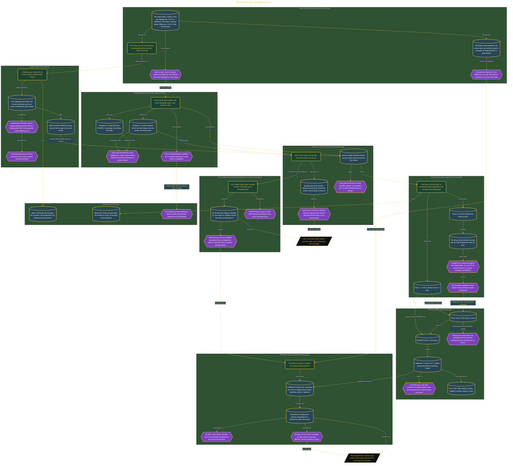

# Tell One Person: Six Dated Actions

> Inside the [Leadership Systems Engineering](../../README.md) portfolio · *Leadership frameworks from formal coursework, engineered as working systems.*

## Overview

I ran a private comparison using six personal plans with fixed completion dates to see whether telling one person supported my follow-through. Date order assigned three plans to TOLD and three to PRIVATE, which prevented me from placing easier or more appealing actions in the group I wanted to perform better. The activity measured my own behavior and did not involve plans that other people expected me to complete.

Before recording any result, I wrote the rule that would determine whether I kept or stopped the practice. The final decision depended on the difference between the TOLD and PRIVATE completion counts, but only if my listener checked in on every TOLD date. Fixing this process first prevented me from changing the assignment method, completion standard, or decision rule after learning which plans I finished.

The architecture is built across **7 phases**, anchored by **Committing to a Private Accountability Practice** on the input side and **Following the Decision Written in Advance** at the end. Each phase is listed in the Implementation section below.

## Architecture

The diagram shows the topology and data flow of the system as built. The full architectural narrative, with screenshots and prose, lives in [`documents/told-versus-private-trial.md`](./documents/told-versus-private-trial.md).

## Implementation

This system is built across **7 phases**:

1. **Committing to a Private Accountability Practice**
2. **Creating a Private Home for the Practice**
3. **Establishing Rules Before Results**
4. **Assigning Plans by Date and Telling a Listener**
5. **Recording Each Dated Outcome**
6. **Comparing TOLD and PRIVATE Results**
7. **Following the Decision Written in Advance**

For the full walkthrough with screenshots and step-by-step content, see [`documents/told-versus-private-trial.md`](./documents/told-versus-private-trial.md).

## Validation

Each build phase below is documented in [`documents/told-versus-private-trial.md`](./documents/told-versus-private-trial.md), with screenshots, configuration, and notes as captured during the build:

- ✅ Committing to a Private Accountability Practice
- ✅ Creating a Private Home for the Practice
- ✅ Establishing Rules Before Results
- ✅ Assigning Plans by Date and Telling a Listener
- ✅ Recording Each Dated Outcome
- ✅ Comparing TOLD and PRIVATE Results
- ✅ Following the Decision Written in Advance
