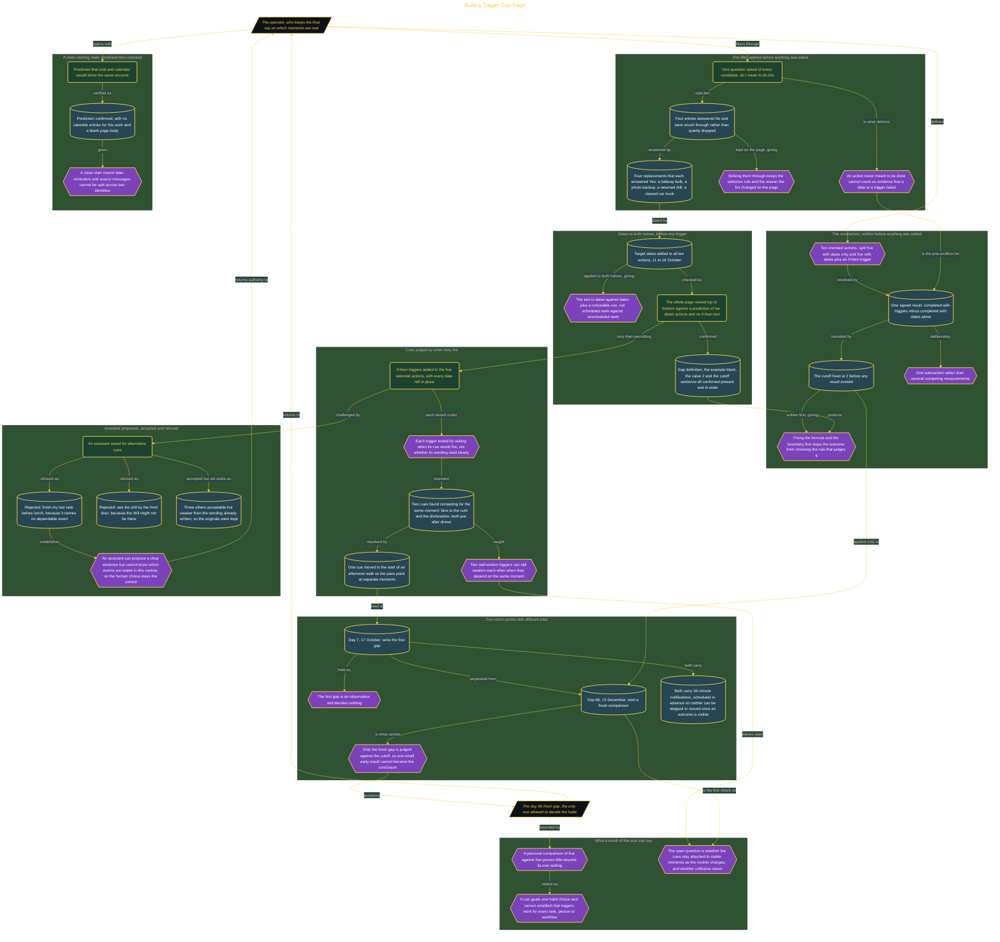

# Build a Trigger Gap Page

> Inside the [Leadership Systems Engineering](../../README.md) portfolio · *Leadership frameworks from formal coursework, engineered as working systems.*

## Overview

I created a small habit comparison to test whether noticeable if-then triggers helped me complete actions I had been postponing. The comparison used ten actions I genuinely intended to finish. Five would keep only their written dates, while five preselected actions would keep their dates and receive triggers tied to specific moments.

The result would be one subtraction: completed dated items without triggers subtracted from completed items with triggers. I fixed the cutoff at 2 before collecting results. A gap meeting that boundary would support keeping the trigger-writing habit during the later review. Fixing the calculation and cutoff first prevented the outcome from changing the rule used to judge it.

The architecture is built across **7 phases**, anchored by **Defining My Response to Postponement** on the input side and **Refining Triggers With Critical Judgment** at the end. Each phase is listed in the Implementation section below.

## Architecture

The diagram shows the topology and data flow of the system as built. The full architectural narrative, with screenshots and prose, lives in [`documents/trigger-gap-comparison.md`](./documents/trigger-gap-comparison.md).

## Implementation

This system is built across **7 phases**:

1. **Defining My Response to Postponement**
2. **Creating a Reliable Project Home**
3. **Filtering for Ten Meaningful Actions**
4. **Designing a Fair Dated Comparison**
5. **Adding Noticeable Triggers Without Losing Dates**
6. **Preparing the Delayed Reading and Fresh Review**
7. **Refining Triggers With Critical Judgment**

For the full walkthrough with screenshots and step-by-step content, see [`documents/trigger-gap-comparison.md`](./documents/trigger-gap-comparison.md).

## Validation

Each build phase below is documented in [`documents/trigger-gap-comparison.md`](./documents/trigger-gap-comparison.md), with screenshots, configuration, and notes as captured during the build:

- ✅ Defining My Response to Postponement
- ✅ Creating a Reliable Project Home
- ✅ Filtering for Ten Meaningful Actions
- ✅ Designing a Fair Dated Comparison
- ✅ Adding Noticeable Triggers Without Losing Dates
- ✅ Preparing the Delayed Reading and Fresh Review
- ✅ Refining Triggers With Critical Judgment
