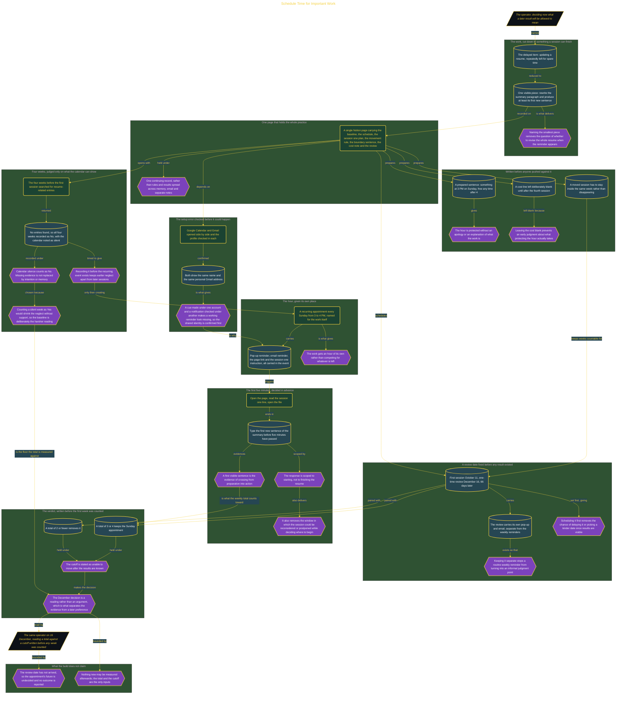

# Schedule Time for Important Work

> Inside the [Leadership Systems Engineering](../../README.md) portfolio · *Leadership frameworks from formal coursework, engineered as working systems.*

## Overview

My delayed item was updating my resume. It mattered to me, but it had remained unscheduled and was repeatedly left for spare time. I reduced that broad item to one visible piece that could be completed in a single sitting: rewriting the resume summary paragraph and producing at least its first new sentence.

Defining the smallest piece gave the weekly appointment a concrete starting point. I would not need to decide whether to revise the entire resume when the reminder appeared. I could open the file, find the summary, and begin one named change. This reduced the distance between seeing the cue and creating visible evidence that the work had started.

The architecture is built across **7 phases**, anchored by **Choosing the Work That Deserves a Weekly Appointment** on the input side and **Applying the Rule Without Changing the Measure** at the end. Each phase is listed in the Implementation section below.

## Architecture

The diagram shows the topology and data flow of the system as built. The full architectural narrative, with screenshots and prose, lives in [`documents/weekly-protected-hour.md`](./documents/weekly-protected-hour.md).

## Implementation

This system is built across **7 phases**:

1. **Choosing the Work That Deserves a Weekly Appointment**
2. **Creating a Home for the Practice**
3. **Establishing an Honest Baseline**
4. **Turning a Calendar Event into a Weekly Cue**
5. **Protecting the Hour Before Pressure Arrives**
6. **Scheduling a Fair 66-Day Review**
7. **Applying the Rule Without Changing the Measure**

For the full walkthrough with screenshots and step-by-step content, see [`documents/weekly-protected-hour.md`](./documents/weekly-protected-hour.md).

## Validation

Each build phase below is documented in [`documents/weekly-protected-hour.md`](./documents/weekly-protected-hour.md), with screenshots, configuration, and notes as captured during the build:

- ✅ Choosing the Work That Deserves a Weekly Appointment
- ✅ Creating a Home for the Practice
- ✅ Establishing an Honest Baseline
- ✅ Turning a Calendar Event into a Weekly Cue
- ✅ Protecting the Hour Before Pressure Arrives
- ✅ Scheduling a Fair 66-Day Review
- ✅ Applying the Rule Without Changing the Measure
